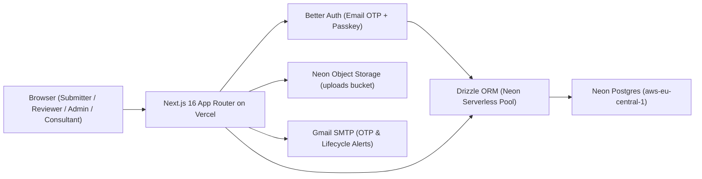
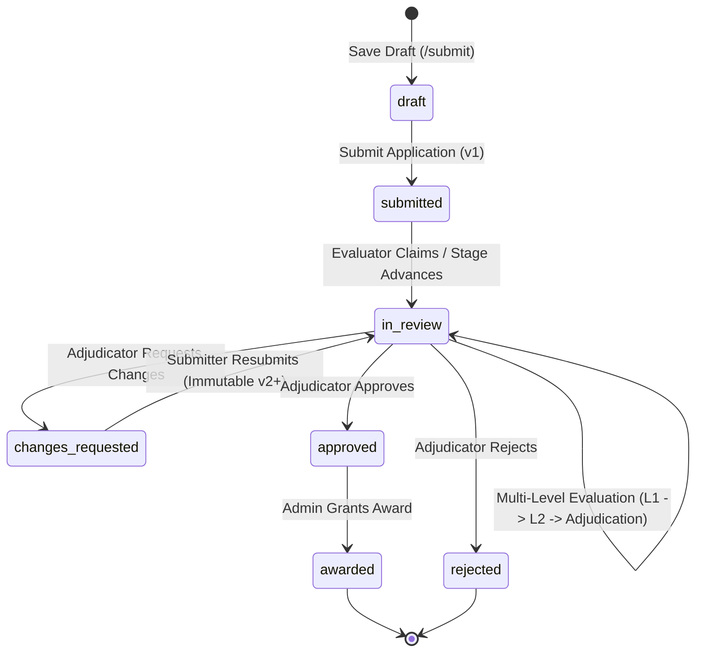

# System Architecture

The **CEDA Innovation Management Portal** is a full-stack **Next.js 16 App Router** application written in TypeScript, backed by **Neon Serverless Postgres** via **Drizzle ORM**, **Better Auth** for authentication, and **Neon Object Storage** (`uploads` bucket) for private file storage.

---

## High-Level System Diagram

---

## Directory & Layer Structure

The repository intentionally keeps root-level directories (`app/`, `components/`, `db/`, `lib/`, `docs/`, `public/`) rather than nesting under `src/`:

| Path | Responsibility |
| :--- | :--- |
| `app/` | Next.js 16 App Router pages, route group layouts, Server Actions (`actions.ts`), and HTTP API Route Handlers (`app/api/*`) |
| `components/` | Reusable UI primitives (`components/ui/*`), domain forms, Recharts visual analytics (`components/admin/ReportsCharts.tsx`), live chat, readiness checker, and duplicate alerts |
| `db/` | Drizzle ORM schema (`schema.ts`, `auth-schema.ts`), database pool (`index.ts`), built-in role definitions (`role-data.ts`), and seed/bootstrap scripts (`seed.ts`, `seed-users.ts`, `bootstrap-admin.ts`) |
| `lib/` | Pure domain engines (`idea-readiness.ts`, `idea-similarity.ts`, `track-pipeline.ts`, `chat-availability.ts`, `chat-analytics-calc.ts`, `reports-analytics.ts`, `portal-content.ts`, `attachments.ts`, `navigation.ts`) and their Vitest unit tests |
| `lib/server/` | `server-only` database queries, transactional services, audit logging, mailers, PDF generation, and storage helpers |
| `drizzle/` | Generated SQL migration files and snapshots managed by `drizzle-kit` |
| `neon.ts` | Declarative Neon Object Storage bucket configuration (`uploads`, `assets`) |

---

## Next.js 16 Route Groups & Rendering Model

Routes are organized into clean domain route groups so each surface gets its own shell, navigation, and security posture:

1. **`app/(landingpage)/`** — Public marketing and informational pages (`/`, `/about`, `/guidelines`, `/news`, `/faq`, `/support`, `/privacy`, `/terms`). Uses the public navbar, footer, and floating consultant live chat button (`GlobalSupportActions`).
2. **`app/(auth)/`** — Authentication flows (`/login`, `/signup`, `/forgot-password`, `/forbidden`) using a distraction-free centered auth layout.
3. **`app/(submissions)/`** — Focused submission & tracking studio (`/submit`, `/track`) with `SubmissionStudioHeader` and DPA 2024 footer.
4. **`app/(workspace)/(dashboards)/`** — Authenticated role workspaces (`/dashboard`, `/evaluator`, `/adjudicator`, `/committee`, `/consultant`, `/admin/*`) wrapped in the RBAC-aware `WorkspaceShell` sidebar with dynamic role navigation (`lib/navigation.ts`).
5. **`app/(workspace)/(account)/`** — Cross-role account management (`/profile`, `/notifications`, `/account/settings`).

### Cache Components & Partial Prefetching

`next.config.ts` enables Next.js 16 **`cacheComponents: true`** and **`partialPrefetching: true`**. Every dynamic Server Component that reads `headers()`, `cookies()`, `searchParams`, or uncached database queries is wrapped inside a `<Suspense>` boundary with a skeleton fallback (`WorkspacePageSkeleton`), allowing Next.js to stream static layout shells immediately while dynamic data resolves.

---

## 5-Stage Innovation Lifecycle Flow

Every transition across the lifecycle executes inside a single **Postgres interactive transaction** (`db.transaction(...)` via `@neondatabase/serverless` `Pool`) that atomically:
1. Updates `ideas.status`, `ideas.currentStageId`, and/or `ideas.currentVersionId`.
2. Appends an immutable row to `idea_stage_history`.
3. Dispatches in-app notifications (`notifications`) respecting user channel preferences (`notification_preferences`).
4. Appends an immutable audit record to `audit_logs`.

After the transaction commits, outbound email alerts are dispatched asynchronously via Gmail SMTP (`dispatchNotificationEmails`).

---

## Database Driver & Timezone Strategy

- **Driver (`db/index.ts`):** Uses `@neondatabase/serverless` `Pool` (WebSocket) rather than HTTP-only queries so lifecycle operations can run multi-statement interactive SQL transactions safely.
- **Snake-Case Mapping:** `casing: "snake_case"` is configured identically in `db/index.ts` and `drizzle.config.ts`.
- **UTC Storage / CAT Display:**
  - `db/index.ts` pins `process.env.TZ = "UTC"` before the first database query so Better Auth's `timestamp without time zone` columns always round-trip as UTC instants.
  - Application tables use `timestamp({ withTimezone: true })` (`timestamptz`).
  - All user-facing dates, timestamps, and live chat business hours are formatted in **`Africa/Gaborone`** (Central Africa Time, `CAT`, UTC+2).

---

## Object Storage Architecture

Private file storage is declared in [`neon.ts`](../neon.ts) and accessed via [`lib/storage.ts`](../lib/storage.ts) using `files-sdk` (`neon({ bucket: "uploads" })`):

- **Submission Attachments:** Stored under `ideas/<ideaId>/<versionOrResubmissionScope>/<uuid>-<sanitizedFileName>`. Draft uploads attach directly to `attachments`; resubmission uploads are staged with HMAC-SHA256 signed tokens (`signStagedAttachmentToken`) until the new `idea_versions` row commits.
- **Admin Document Templates:** Stored under `documents/<uuid>-<sanitizedFileName>` and tracked in the `documents` table.
- **Downloads:** Direct bucket URLs are never exposed. All downloads flow through `/api/attachments/[id]` or `/api/documents/[id]`, which verify authorization and issue a 302 redirect to a short-lived (5-minute) presigned S3 URL with `Content-Disposition: attachment` and `Cache-Control: private, no-store`.
