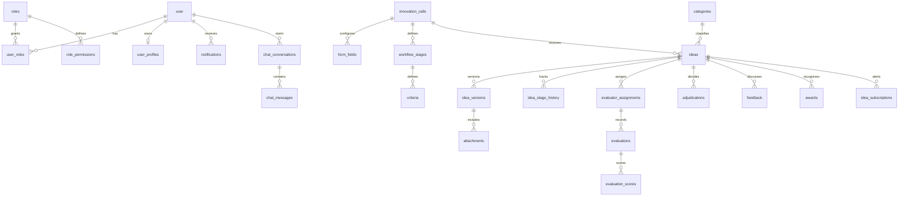

# Database Schema & Seeding

The portal uses **Neon Serverless Postgres** managed with **Drizzle ORM** (`db/schema.ts` + `db/auth-schema.ts`). The schema comprises **35 tables** across 8 functional domains.

---

## Conventions

- **Naming:** Drizzle `casing: "snake_case"` maps TypeScript camelCase properties directly to snake_case Postgres columns.
- **Primary Keys:** Application tables use `uuid` primary keys (`defaultRandom()`). Better Auth identity tables use `text` primary keys, so every user foreign key (`submitterId`, `actorId`, `evaluatorId`, etc.) is `text`.
- **Data-Driven Configuration:** Stable small sets use Postgres enums; everything an administrator may extend (roles, workflow stages, scoring criteria, dynamic form fields, categories, content blocks) is modeled as table rows so zero schema migrations are needed for configuration changes.
- **Append-Only Tables:** `idea_stage_history` and `audit_logs` are append-only for full lifecycle traceability and Botswana DPA 2024 compliance.

---

## Postgres Enums

| Enum | Values |
| :--- | :--- |
| `call_status` | `draft`, `open`, `closed`, `archived` |
| `stage_type` | `intake`, `screening`, `evaluation`, `adjudication`, `feedback`, `decision`, `award` |
| `idea_status` | `draft`, `submitted`, `in_review`, `changes_requested`, `approved`, `rejected`, `awarded`, `withdrawn` |
| `field_type` | `text`, `textarea`, `number`, `select`, `multiselect`, `checkbox`, `date`, `url` |
| `assignment_status` | `pending`, `in_progress`, `submitted`, `declined` |
| `adjudication_decision` | `approved`, `rejected`, `needs_revision` |
| `notification_channel` | `in_app`, `email`, `sms` |
| `chat_status` | `waiting`, `active`, `closed` |

---

## Entity-Relationship Overview

---

## Table Reference by Domain

### 1. Better Auth Identity (`db/auth-schema.ts`)
| Table | Purpose |
| :--- | :--- |
| `user` | Core user identity (`id`, `name`, `email`, `emailVerified`, `phoneNumber`, `phoneNumberVerified`) |
| `session` | Active login sessions (`token`, `expiresAt`, `ipAddress`, `userAgent`) |
| `account` | Auth provider credentials (`providerId = "credential"`, scrypt password hash) |
| `verification` | Hashed 6-digit email OTP verification & password-reset tokens |
| `passkey` | WebAuthn passkey credentials (`publicKey`, `credentialID`, `counter`, `deviceType`, `backedUp`) |

### 2. Access Control & Profiles (`db/schema.ts`)
| Table | Purpose |
| :--- | :--- |
| `roles` | Built-in and extensible portal roles (`isSystem` prevents deleting built-ins) |
| `role_permissions` | Fine-grained permission strings (`idea:submit`, `evaluation:score`, `adjudication:decide`, `chat:manage`, etc.) |
| `user_roles` | Many-to-many role assignments with `assignedBy` and `assignedAt` |
| `user_profiles` | Organisation, job title, `isInternal` (CEDA staff vs external innovator), and `dataConsentAt` (DPA 2024 consent timestamp) |

### 3. Innovation Calls & Configuration
| Table | Purpose |
| :--- | :--- |
| `categories` | Submission sectors/categories with historical-safe `isActive` toggle |
| `innovation_calls` | Calls/opportunities (`title`, `slug`, `status`, `opensAt`, `closesAt`) |
| `form_fields` | Admin-configurable dynamic fields per call (`key`, `type`, `required`, `options`, `sectionKey`, `sectionPosition`, `position`, `isActive`) |
| `workflow_stages` | Ordered workflow stages per call (`key`, `name`, `type`, `position`, `isTerminal`) |

### 4. Ideas, Versions & Tracking
| Table | Purpose |
| :--- | :--- |
| `ideas` | Master idea record (`referenceNo` e.g. `CEDA-2026-A1B2C3D4`, `status`, `currentStageId`, `currentVersionId`) |
| `idea_versions` | Immutable version snapshots (`versionNo`, `title`, `summary`, `answers` JSONB, `termsAcceptedAt`, `submittedAt`) |
| `idea_collaborators` | Per-idea collaborator memberships (`ideaId`, `userId`, `role`) |
| `attachments` | Private Neon Object Storage references tied to a specific `ideaVersionId` (`fileName`, `fileUrl` storage key, `fileSize`, `mimeType`) |
| `idea_stage_history` | Append-only workflow transitions (`fromStageId`, `toStageId`, `toStatus`, `actorId`, `note`, `createdAt`) driving timelines & turnaround analytics |

### 5. Evaluation, Adjudication, Feedback & Awards
| Table | Purpose |
| :--- | :--- |
| `criteria` | Weighted scoring criteria per evaluation stage (`maxScore`, `weight`, `isArchived` — archived instead of deleted once scored) |
| `evaluator_assignments` | Evaluator claims/assignments (`ideaId`, `stageId`, `evaluatorId`, `status`, `dueAt`) |
| `evaluations` | Version-locked evaluation records (`assignmentId`, `ideaVersionId`, `overallComment`, cached weighted `totalScore`, `submittedAt`) |
| `evaluation_scores` | Per-criterion numeric score and written comment |
| `adjudications` | Formal adjudication decisions (`approved`, `rejected`, `needs_revision`), `finalScore`, `rationale`, `decidedAt` |
| `feedback` | Threaded feedback (`parentId`) with `isInternal` flag isolating evaluator-only notes from submitter-visible comments |
| `awards` | Formal recognition records (`title`, `tier`, `description`, `awardedBy`, `awardedAt`) |

### 6. Notifications & CMS Content
| Table | Purpose |
| :--- | :--- |
| `notifications` | User in-portal alert inbox (`type`, `title`, `body`, `readAt`) |
| `notification_preferences` | Per-user opt-in/out for `in_app`, `email`, and `sms` channels |
| `idea_subscriptions` | Free status alert subscriptions (`userId`, `ideaId`) used by owners, `/track`, and `/committee` |
| `faqs` | Admin-managed public FAQs (`topic`, `question`, `answer`, `position`, `isPublished`) |
| `content_blocks` | Admin-managed public page copy & announcements (`key` e.g. `guidelines.overview`, `news.banner`, `news.<slug>`) |
| `documents` | Admin-managed downloadable templates backed by Neon Object Storage (`callId`, `title`, `fileName`, `fileUrl`, `isPublished`) |

### 7. Governance & Live Support Chat
| Table | Purpose |
| :--- | :--- |
| `audit_logs` | Immutable governance trail (`actorId`, `action`, `entityType`, `entityId`, `metadata`, `ipAddress`, `userAgent`, `createdAt`) |
| `system_settings` | Key/value JSONB settings (e.g., `chat.public_holidays`, `chat.max_concurrent_per_agent`) |
| `chat_conversations` | Live support threads (`requesterId`, `agentId`, `status`, `startedAt`, `closedAt`) |
| `chat_messages` | Persistent chat messages (`conversationId`, `senderId`, `body`, `createdAt`) |

---

## Database Scripts & Seeding

| Command | Script | Purpose |
| :--- | :--- | :--- |
| `npm run db:generate` | `drizzle-kit generate` | Generates SQL migrations from `db/schema.ts` changes |
| `npm run db:migrate` | `drizzle-kit migrate` | Applies pending migrations to `DATABASE_URL` |
| `npm run db:push` | `drizzle-kit push` | Pushes schema directly (development convenience) |
| `npm run db:studio` | `drizzle-kit studio` | Opens Drizzle Studio visual database browser |
| `npm run db:seed` | `tsx db/seed.ts` | Idempotently seeds built-in roles, categories, default 2026 Hackathon call, 8 workflow stages, evaluation criteria, required proposal URL field, and starter FAQs |
| `npm run db:seed-users` | `tsx db/seed-users.ts` | Idempotently seeds 6 pre-verified demo/test accounts (one per role) hashed with Better Auth (`Password123!`) |
| `npm run db:bootstrap-admin` | `tsx db/bootstrap-admin.ts` | Grants `admin` role to the email-verified account configured in `CEDA_BOOTSTRAP_ADMIN_EMAIL` and records an audit event |
